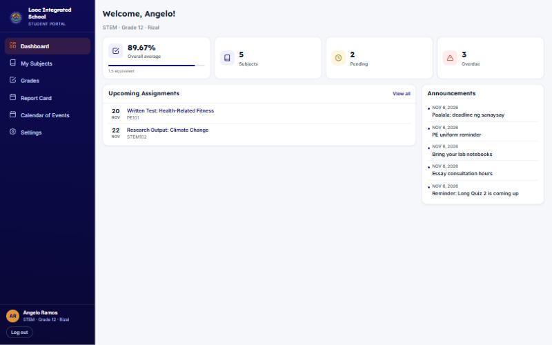
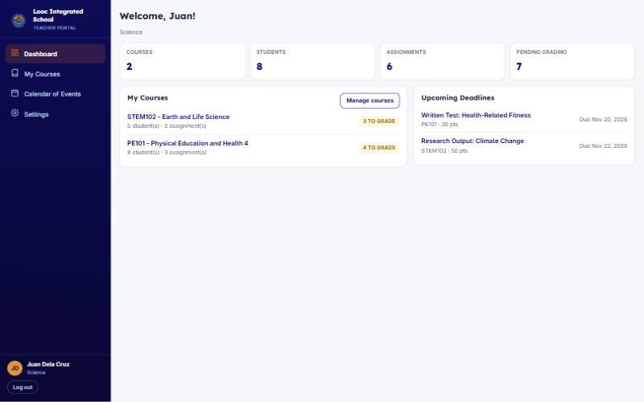

# Looc Integrated School LMS

A simple Learning Management System for Looc Integrated School, built for student and teacher use: courses, assignments, grades, materials, announcements, a calendar of events, and a report card.

**Live demo:** https://looc-lms.vercel.app

## Screenshots

**Student Dashboard**


**Teacher Dashboard**


## Tech Stack

- **Frontend:** HTML, CSS, JavaScript (vanilla, no framework) — deployed on Vercel
- **Backend:** ASP.NET Core Web API (.NET 10) — deployed on Render
- **Database:** MySQL (hosted on Aiven)

## Project Structure

```
looc-lms/
├── frontend/           # Static site (HTML/CSS/JS)
│   ├── css/
│   ├── js/
│   └── *.html
└── backend/
    └── Project 2/       # ASP.NET Core Web API
        ├── Controllers/
        ├── Model/
        ├── Data/
        └── Migrations/
```

## Running Locally

**Backend**
```bash
cd "backend/Project 2"
dotnet user-secrets set "ConnectionStrings:DefaultConnection" "<your MySQL connection string>"
dotnet run
```

**Frontend**

Open `frontend/index.html` with a local server (e.g. the VS Code Live Server extension), or point `frontend/js/config.js`'s `API_BASE_URL` at your running backend and open the files directly.

## Features

- Student and teacher login (with Google sign-in)
- Courses/subjects, materials, and announcements
- Assignments and submissions
- Gradebook and auto-computed grade equivalents
- Report card
- Calendar of events
- Account settings (profile edit, change password)

## Notes

- No JWT/session tokens yet — login stores a profile in `localStorage`. Fine for a school project demo; flagged as a future improvement if real authentication is needed.
- The backend is on Render's free tier, which spins down when idle — the first request after inactivity can take 30–60 seconds.
